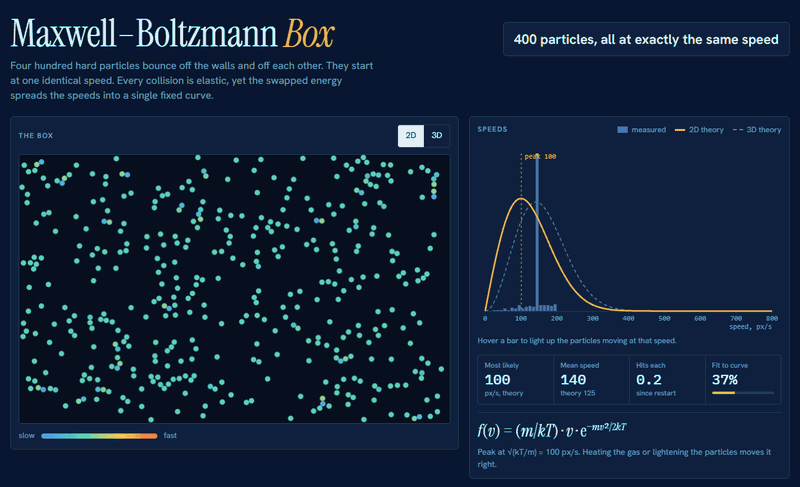

# Maxwell–Boltzmann Box

**[Open the live demo](https://rrtrytcg.github.io/maxwell-boltzmann-box/)**. It is one HTML file with no build step and no dependencies.

Four hundred hard particles bounce around a box, off the walls and off each other. Every collision is elastic. They all start at exactly the same speed, and after a few collisions each, the speeds spread into the Maxwell–Boltzmann distribution: the spread of speeds that elastic collisions settle a gas into at temperature $T$.

## The physics

In two dimensions each velocity component is Gaussian with variance $kT/m$, so the speed has density

$$f(v) = \frac{m}{kT}\, v\, e^{-mv^2/2kT}$$

peaking at $\sqrt{kT/m}$. Heating the gas or lightening the particles moves the peak right.

In three dimensions the shell of equal speeds grows as $v^2$ rather than $v$, which gives the familiar

$$f(v) = 4\pi \left(\frac{m}{2\pi kT}\right)^{3/2} v^2\, e^{-mv^2/2kT}$$

| | 2D | 3D |
|---|---|---|
| Most likely speed | $\sqrt{kT/m}$ | $\sqrt{2kT/m}$ |
| Mean speed | $\sqrt{\pi kT/2m}$ | $\sqrt{8kT/\pi m}$ |
| RMS speed | $\sqrt{2kT/m}$ | $\sqrt{3kT/m}$ |

## Things to try

- **Watch it form.** The default start gives every particle the same speed, so the histogram opens as a single spike. The *Fit to curve* readout starts around 40% and reaches the mid-90s within a few collisions per particle (*Hits each*). The ¼× time setting slows this down.
- **Hover a bar** in the histogram. The particles moving at that speed light up in the box, and the matching ring lights up in the velocity-space panel.
- **Velocity space** shows why the peak is not at zero. Dots crowd the middle, but the ring at speed $v$ is longer the larger $v$ is. Crowding falls with $v$, ring length rises, and the product peaks.
- **Heat it or lighten it.** The temperature and mass sliders move the whole curve. The most likely speed scales as $\sqrt{T/m}$.
- **Switch to 3D.** The dashed ghost curve shows the other dimension's prediction, so you can see the peak move right.
- **Restart from** *Slow and fast camps* for a two-humped start, or *Already settled* to begin on the curve.

## How it works

- The particles are equal-mass hard disks (2D) or spheres (3D). A collision swaps the velocity component along the line between the two centres, which conserves energy and momentum.
- Collisions are found with a uniform grid. Each frame is split into small substeps so that fast particles cannot pass through each other.
- The walls are perfectly reflecting.
- A weak thermostat multiplies every particle's velocity by the same factor, nudging the gas toward the temperature and mass you set (time constant about 0.6 s of simulation time). A uniform factor leaves the shape of the distribution alone, so the curve is produced by the collisions. The thermostat only moves the gas to the target and keeps numerical drift out.
- Speeds are in px/s, with $kT/m = (100\ \text{px/s})^2 \cdot T/m$ using the slider values. At $T=1$, $m=1$ the most likely 2D speed is 100 px/s.
- *Fit to curve* is 1 minus the Kolmogorov–Smirnov distance between the particles' speeds and the theoretical cumulative distribution.
- Histogram bars are 10 px/s wide and normalised to unit area, so they sit on the same scale as the curve. *Average over time* smooths them over roughly four seconds.
- Particles are drawn slightly larger as they get heavier. The 3D box is 800 × 500 × 110 and is drawn with a simple perspective, and the histogram uses the full 3D speed.

## Run it locally

Open `index.html` in a browser. The fonts load from Google Fonts, and the page falls back to system fonts when offline. The page follows your system light or dark theme.
